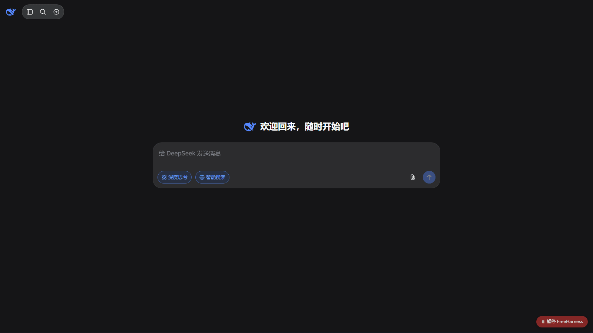

# FreeHarness — 解放网页 AI

[](LICENSE)
[]()
[]()

让你**已经登录的网页版 AI**（DeepSeek / 智谱 / 通义 / 元宝 / 豆包 / ChatGPT / Claude / Gemini / Kimi）能直接操作这台电脑：执行命令、读写文件、截图看图、点鼠标。

不需要 API key，也不需要另外订阅——用的是你网页版账号自己的额度。

<p align="center"></p>

## 它怎么工作

网页 AI 本身只能在对话框里输出文字。FreeHarness 在中间加了一层"翻译"：

```
网页 AI 回复 [TOOL_CALL]{...}
      │
      ▼  ① 浏览器扩展监听到 AI 消息稳定
本地服务 127.0.0.1:8765
      │  ② 在本机执行：命令 / 读写文件 / 截图 / 鼠标键盘
      ▼  ③ 结果转成 JSON
网页输入框自动填入 [TOOL_RESULT] 并发送 ──▶ AI 继续，直到任务结束
```

- **浏览器扩展**：识别网页里的 AI 回复，提取工具调用，把执行结果填回对话框
- **本地服务**：一个零依赖的 Python 脚本（`server/harness_server.py`），只监听 `127.0.0.1:8765`
- **提示词**：告诉 AI 有哪些工具、怎么输出调用格式。扩展内置了按平台定制的版本，一键注入

## 能做什么

几个真实跑通的例子：

- "看看我桌面有什么文件，按类型整理一下"
- "把 `D:\notes` 里所有 txt 合并成一个 notes_all.txt"
- "截个图，看看屏幕上现在是什么，然后点开计算器"
- "查一下本机 IP 和磁盘剩余空间，写一份报告存到桌面"
- "读一下剪贴板内容，帮我总结"

## 适合什么，不适合什么

**适合**

- 想低成本体验一下 Agent 是什么感觉（不买 API、不订阅）
- 学习 harness / tool-calling 的实现原理
- 本机轻量自动化：整理文件、截图、点几下鼠标

**不适合**

- 要求稳定可靠的生产任务——网页 AI 会改版、会限流，DOM 适配随时可能失效
- 长上下文的大任务——网页版对话有长度限制，跑几十轮后容易丢上下文
- 7×24 无人值守——免费额度有限，长时间高频使用会触发平台限流（见下方「局限」）

## 支持平台

| 平台 | 核心工具（命令 / 文件 / 图片） | GUI 工具（鼠标键盘 / 窗口 / 剪贴板 / 截图） |
|---|---|---|
| **Windows 10/11** | ✅ 零依赖 | ✅ 零依赖（截图需 `pip install pillow`） |
| **macOS 11+** | ✅ 零依赖 | ✅ 系统自带（osascript / screencapture / pbcopy）；首次需在「系统设置 → 隐私与安全性 → 辅助功能」授权终端或 Python |
| **Linux (X11)** | ✅ 零依赖 | ⚠️ 需安装：`sudo apt install xdotool xclip imagemagick`（Wayland 用 `wl-clipboard` + `grim`，窗口控制受限） |

> iOS / Android 不支持：手机上没有可运行的本地 Python 服务，移动端浏览器扩展也不允许启动本地进程。

## 安装（约 2 分钟）

需要 Python 3.8+（`python --version` / `python3 --version` 可查）。

### 第 1 步：启动本地服务

**Windows**：双击 `server\start_server.bat`

**macOS / Linux**：

```bash
cd server && chmod +x start_server.sh && ./start_server.sh
```

看到启动横幅即成功。窗口保持开着（用完可关闭）。

**可选：点扩展图标时自动拉起服务**

配一次后，服务没在运行时点扩展图标会自动启动它。在项目根目录执行：

```
# Windows
python server\launcher\install_host.py

# macOS / Linux
python3 server/launcher/install_host.py
```

Windows 写注册表（HKCU，无需管理员）；macOS / Linux 把 host manifest 复制到浏览器的 `NativeMessagingHosts` 目录。移动项目目录或扩展 ID 变化后，带新 ID 重跑：`install_host.py <扩展ID>`。

### 第 2 步：安装扩展

1. 打开 `edge://extensions`（Chrome 是 `chrome://extensions`）
2. 打开右上角/左侧的 **「开发人员模式」**
3. 点 **「加载解压缩扩展」**
4. 选择本项目的 `extension` 文件夹（不是仓库根目录）
5. 工具栏出现 FreeHarness 图标即成功

### 第 3 步：开始用

1. 打开任意支持的 AI 站点，新开一个对话
2. 点扩展图标 → 点 **「注入提示词」**（会自动填入并发送本平台的提示词）
3. 等 AI 回复"就绪/明白"后，直接下达任务，例如"看看我桌面有什么文件"
4. 之后 AI 输出 `[TOOL_CALL]` → 本地执行 → 结果自动发回 → 循环，直到任务完成

不想用自动注入？打开 `PROMPT_TEMPLATE.md` 手动复制粘贴，内容完全一致。

## 工具一览（18 个）

| 工具 | 说明 |
|---|---|
| run_command | 执行系统命令（Windows 为 cmd，macOS/Linux 为 sh；超时杀整进程树） |
| read_file / write_file / append_file | 文件读写（自动建目录；read_file 拒绝二进制，避免撑爆对话） |
| list_dir | 列目录（类型 / 大小 / 修改时间） |
| screenshot | 截图存 PNG（默认存临时目录，只保留最近 20 张） |
| view_image | **让 AI 直接"看到"图片**——图片作为附件自动上传，多模态识图 |
| open_app | 打开程序 / 文件 / 网址（系统关联方式） |
| clipboard_read / clipboard_write | 剪贴板文本读写 |
| list_windows / activate_window | 枚举可见窗口 / 按标题关键词激活窗口 |
| mouse_move / mouse_click | 移动光标 / 点击（支持双击） |
| mouse_scroll / mouse_drag | 滚轮滚动 / 按住左键拖拽 |
| key_press / type_text | 按键组合 / 整段文字输入（中文友好） |

**看图的正确用法**：先 `screenshot` 存图 → 再 `view_image`（可带 `prompt` 说明看图后要做什么）→ 图片自动作为附件发出，AI 用视觉能力直接查看。不要用 `read_file` 读图片。

## 提示词与按平台定制

点扩展图标 → **「注入提示词」** 一键完成；**「设置」** 里可以：

- **编辑人设**：定义语气风格（可留空）
- **选择工具分类**：命令行 / 文件读写 / 截图看图 / 程序与窗口 / 剪贴板 / 鼠标键盘，默认全选；取消的分类不会出现在提示词里
- **预览**：注入前可以看完整内容

注入时自动识别当前系统，**只使用本平台的说明**（命令 shell、路径示例、转义规则），不会把其它平台的内容发给 AI。

核心提示词的源文件是 `PROMPT_TEMPLATE.md`（两个 `---` 之间的正文）：工具按 `<!--cat:xxx-->` 标记分类、`{{PLACEHOLDER}}` 标记平台差异。改完跑一次 `python build_prompts.py` 会按 Windows / macOS / Linux 分别生成到 `extension/prompts.js`，再重载扩展。

## 失败时会发生什么

工具执行失败时，页面右上角会弹一个红色浮层（同类 30 秒内不重复），直接告诉你怎么办：

- **扩展与本地服务通信异常** → 刷新本页（Ctrl+F5）或到 `edge://extensions` 重新加载扩展
- **结果自动发送失败**（站点接口改版）→ 刷新页面重试；结果已自动复制到剪贴板，可手动粘贴

完整执行日志：浏览器 DevTools 控制台搜 `[FreeHarness]`，或点扩展图标的「执行日志」。

## 安全设计

- 本地服务**只监听 `127.0.0.1`**，外网无法访问
- 强制 `Content-Type: application/json`：浏览器"简单请求"（`text/plain` 等，不触发 CORS 预检）会被 403 拒绝，堵住恶意网页绕过 CORS 调本地服务的通道
- 高危命令黑名单：`format`、`diskpart`、`rm -rf /`、`rd /s /q 盘根`、`shutdown` 等
- 命令超时上限 300 秒，输出截断
- 防死循环：**默认不限轮次**（可在设置里自设上限，0 = 不限制）；连续 3 轮完全相同的调用自动停止；90 秒无操作自动视为新任务重置计数
- **页面右下角有悬浮按钮「⏸ 暂停 FreeHarness」**：觉得 AI 跑偏了，点一下立刻停止执行与回传（再点恢复）；popup 的「启用」开关状态与它同步
- 弹窗里的**总开关**随时可关，关掉后扩展只旁观不执行

⚠️ 黑名单之外，AI 能执行任意命令。重要数据请自行备份；不确定的任务可以关掉"自动发送结果"，看清楚每一步再手动放行。

## 常见问题

**Q: AI 没有输出 `[TOOL_CALL]` 格式？**
回复它："请严格按 `[TOOL_CALL]...[/TOOL_CALL]` 格式重新输出你的工具调用"。协议解析已容错代码围栏、全角引号、非法转义、裸换行，但标记本身必须存在。

**Q: 扩展没反应？**
1. 点扩展图标，看服务状态是否绿灯
2. `F12` 控制台搜 `[FreeHarness]` 看日志
3. 确认网站在 `extension/manifest.json` 的 matches 列表里
4. AI 正在生成（有停止按钮）时扩展故意不动，等生成完

**Q: 执行了但没自动发回？**
该站输入框 DOM 可能改版。日志里会有"自动发送失败"，结果已进剪贴板，粘贴发送即可；然后按下一节修适配器。

**Q: 换了新网站 / DOM 改版怎么适配？**
编辑 `extension/adapters.js`：

- 给已有适配器的选择器候选列表加新选择器（改完在 `edge://extensions` 点"重新加载"，再刷新网页）
- 新网站：在 `ADAPTERS` 数组加一项，参照现有写法提供 `lastAssistant / input / fill / send`；再把域名加进 `manifest.json` 的 matches
- 用 F12 元素检查器找：AI 消息容器的稳定 class、输入框、发送按钮

**Q: 通用模式抓错消息？**
未适配站点走启发式适配器，可能把你的消息当成 AI 消息。日志会显示适配名——出现"通用"且行为异常时，建议为该站写专用适配器。

**Q: 能跑 Python 脚本吗？**
可以，直接 `run_command`：`{"tool":"run_command","params":{"command":"python D:\\work\\script.py"}}`（macOS/Linux 用 `python3 /path/to/script.py`）。

## 局限

- 网页 AI 免费版有消息条数/频率限制，长任务可能撞限额；高频长时间运行会触发平台限流
- DOM 适配依赖各网站前端结构，改版需更新 `adapters.js`（改一个选择器就能修）
- 鼠标键盘是物理操作，执行期间会接管光标与焦点，别和它抢
- 本项目在快速迭代中，接口和行为可能有变化

## 目录结构

```
webharness/
├── server/
│   ├── harness_server.py     本地执行服务（跨平台，零依赖，Python 3.8+）
│   ├── platforms/            平台后端层
│   │   ├── win32_backend.py    Windows：ctypes 直调 Win32，零依赖
│   │   ├── darwin_backend.py   macOS：osascript / pbcopy / screencapture
│   │   └── linux_backend.py    Linux：xdotool / xclip / grim
│   ├── start_server.bat      启动（Windows）
│   ├── start_server.sh       启动（macOS / Linux）
│   └── launcher/             点扩展图标自动拉起服务（Native Messaging）
├── extension/
│   ├── manifest.json
│   ├── protocol.js           工具调用解析（纯函数，可单测）
│   ├── adapters.js           各网站 DOM 适配器
│   ├── prompts.js            核心提示词（由 build_prompts.py 生成）
│   ├── content.js            主循环：监听 → 执行 → 发回
│   ├── background.js         转发到本地服务
│   └── popup.html/js         控制台：开关 / 状态 / 提示词注入 / 日志
├── build_prompts.py           从 PROMPT_TEMPLATE.md 生成 prompts.js
└── PROMPT_TEMPLATE.md         提示词源文件
```

## 测试

```bash
node test_protocol.js          # 协议解析单测（23 项）
python server/test_server.py   # 服务端工具单测（55 项）
```
